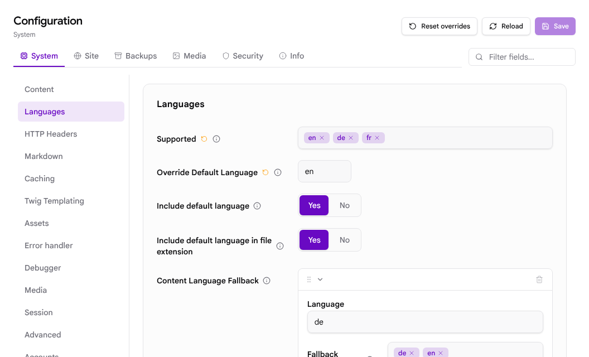
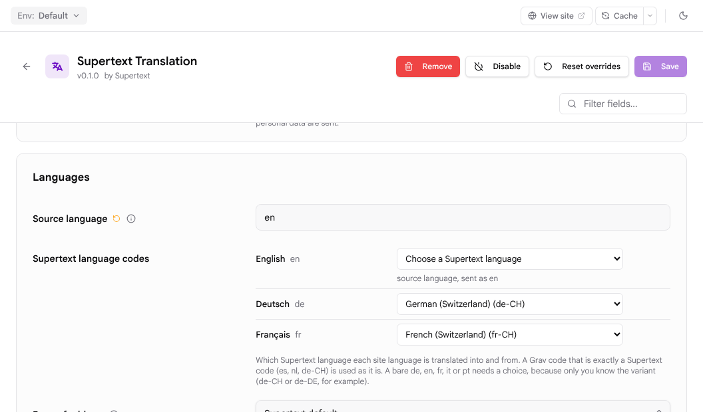

# Installation and configuration

This guide is for administrators of a Grav site. It covers installing the plugin, connecting it to Supertext, setting up languages and every setting.

## Requirements

- Grav **2.0 or later** (tested with Grav 2.2.4)
- The **Admin2** and **API** plugins (bundled with the "Grav + Admin" download; Admin2 ≥ 2.1, API ≥ 1.0.44)
- PHP 8.3 or later with the `curl`, `dom` and `mbstring` extensions (all standard)
- Outgoing HTTPS from the web server to `api.supertext.com`
- A Supertext account with an API key for AI translation (see [API key](#api-key))
- At least two site languages (see [Language setup](#language-setup))

The classic Grav 1.x admin is not supported: the plugin adds its button to the Admin2 page editor.

## Install

The plugin is not in the Grav package index (GPM) yet; install it from GitHub.

**From a release (recommended):**

1. Download `supertext-translation-<version>.zip` from the [Releases page](https://github.com/Supertext/Grav-Supertext-Translation/releases).
2. Unzip it into `user/plugins/`. It already contains the folder **`supertext-translation`** with `supertext-translation.php` inside.
3. In the admin, open **Plugins**: *Supertext Translation* is listed and enabled. If it isn't, enable it.

**From the main branch:** download the repository as a ZIP from <https://github.com/Supertext/Grav-Supertext-Translation> (*Code → Download ZIP*), unzip it into `user/plugins/` and rename the folder to **`supertext-translation`**, then enable it as above.

**With Git:**

```bash
cd user/plugins
git clone https://github.com/Supertext/Grav-Supertext-Translation.git supertext-translation
```

The plugin has no Composer dependencies to install; it uses the libraries Grav already ships.

### Update

Replace the `user/plugins/supertext-translation` folder with the new version (or `git pull` in it), then clear the cache (**Cache** button in the admin, or `bin/grav clear`). Your settings in `user/config/plugins/supertext-translation.yaml` are kept.

### Uninstall

Remove the plugin in **Plugins → Supertext Translation → Remove**, or delete `user/plugins/supertext-translation` and `user/config/plugins/supertext-translation.yaml`.

Translations already made stay as normal Grav language files (`default.de.md` etc.). They contain a small `supertext:` block in their front matter, which Grav ignores; you can leave it or delete it.

## API key

1. **Supertext account:** no account yet? [Create one at supertext.com](https://www.supertext.com/person/en/account/signin) (log in or create an account with your email address).
2. **API key:** generate it at [supertext.com → Integrations → API](https://www.supertext.com/en/integrations/api). This requires the **Admin** role in your Supertext account; if you don't have it, ask your Supertext account's administrator.

Supertext shows the key as `Supertext-Auth-Key …`; paste it with or without that prefix. The plugin settings show the same two links below the API key field.

You can store it in one of two places:

- **In the admin:** **Plugins → Supertext Translation → API key**, then **Save**. It is stored in `user/config/plugins/supertext-translation.yaml`.
- **As an environment variable** `SUPERTEXT_API_KEY` on the server. It is used when the setting is empty. This keeps the key out of the `user/` folder (and out of Git if you version it). With Apache and `mod_php`, pass it through with `PassEnv SUPERTEXT_API_KEY`.

Only users who can change plugin settings (super administrators) see or change the key. Editors never see it.

Every time you save the plugin settings, the plugin checks the key with Supertext (a cost-free request, nothing is translated or billed) and shows the result under **API key check**, with the time of the check. **Check again** runs the check right away, for example after you changed `SUPERTEXT_API_KEY`. A key from the environment is also checked automatically when it changes. An invalid key never stops the settings from being saved; see [Troubleshooting](#troubleshooting) for the messages.

## Language setup

Grav keeps each language of a page in its own file (`default.en.md`, `default.de.md`, …). Set up the languages in **Configuration → System → Languages**:



- **Supported:** all languages of the site, e.g. `en`, `de`, `fr`. The plugin offers every one of them except the source language.
- **Override Default Language:** the main language. By default it is also the language the plugin translates from.
- **Include default language in file extension:** recommended *Yes*, so source pages are saved as `default.en.md`. Pages saved as `default.md` (no language) also work as the source.
- **Content Language Fallback** (optional): what visitors see for a page that has no published translation yet. `de: [de, en]` shows the English page; `de: [de]` shows "not found".

The same settings in `user/config/system.yaml`:

```yaml
languages:
  supported: [en, de, fr]
  default_lang: en
  include_default_lang_file_extension: true
  content_fallback:
    de: [de, en]
    fr: [fr, en]
```

Grav's own theme has no language menu; visitors reach the languages under `/de/`, `/fr/` etc. Add a language switcher to your theme if you need one.

### Supertext languages

Supertext needs to know exactly which language variant each site language is: Swiss or German German, British or American English. The plugin never guesses. Under **Plugins → Supertext Translation → Supertext language codes** every site language has a list of the languages Supertext offers:



- A Grav code that is exactly a Supertext code is chosen automatically: `de-ch` → `de-CH`, `es` → `es`, `nl` → `nl`.
- A bare `de`, `en`, `fr`, `it` or `pt` has no automatic choice, because Supertext only offers them with a region. Choose the variant, e.g. `de` → *German (Switzerland) (de-CH)*. Until you do, the row says **Not mapped** and editors can't translate into that language (the panel shows it greyed out).
- The source language uses the same list: a source mapped to `de-CH` is sent as `de`. A bare source code such as `en` needs no choice.
- Save the settings after changing the list.

The languages Supertext offers (October 2026):

| Language | Supertext codes |
| --- | --- |
| German | `de-CH`, `de-DE`, `de-AT` |
| English | `en-GB`, `en-US` |
| French | `fr-CH`, `fr-FR` |
| Italian | `it-CH`, `it-IT` |
| Portuguese | `pt-BR`, `pt-PT` |
| Chinese | `zh-Hans` (Simplified), `zh-Hant` (Traditional) |
| Serbian | `sr-Latn` (Latin), `sr-Cyrl` (Cyrillic) |
| Swiss German | `gsw-u-sd-chzh` (Zurich), `gsw-u-sd-chbe` (Bern) |
| All others, without region | `bg`, `cs`, `da`, `el`, `es`, `fi`, `hr`, `hu`, `ja`, `ko`, `nb`, `nl`, `pl`, `rm`, `ru`, `sk`, `sl`, `sq`, `sv`, `tr` |

Supertext rejects other forms, e.g. `es-ES`, `sl-SI` or `zh-CN`. Formal and informal address (*Form of address*) exist for all of them except English, Romansh (`rm`), Albanian (`sq`), Serbian and Swiss German; those always get Supertext's default, and the language list says so next to them.

In YAML, the setting is a map of Grav codes to Supertext codes:

```yaml
language_codes:
  de: de-CH
  fr: fr-CH
  en: en-GB
```

## Settings

All settings are in **Plugins → Supertext Translation**:


| Setting | YAML key | Default | What it does |
| --- | --- | --- | --- |
| Plugin status | `enabled` | enabled | Turns the plugin (button and API routes) on or off. |
| API key | `api_key` | empty | Your Supertext API key. Empty: the `SUPERTEXT_API_KEY` environment variable is used. |
| API key check | – | – | Shows the latest automatic check of the key (not a setting). **Check again** checks it now. |
| API endpoint | `api_url` | `https://api.supertext.com/v1/` | Only change it if Supertext tells you to. |
| Send version information to Supertext | `version_reports` | enabled | Sends the site URL and the versions of this plugin, Grav and PHP to Supertext when you save these settings and after an update, so Supertext support can see which version you run. No content, no API key and no personal data. See [Version information](#version-information-and-the-ping-address). The environment variable `SUPERTEXT_VERSION_REPORTS=0` turns it off (and `1` on) whatever the setting says. |
| Source language | `source_language` | empty | Grav language code the translations are made from. Empty: the site's default language. |
| Supertext language codes | `language_codes` | none | The Supertext language of each site language, e.g. `de` → `de-CH` (Swiss German, no "ß"), `fr` → `fr-CH`. A Grav code that is exactly a Supertext code (`es`, `nl`, `de-CH`) needs no entry; a bare `de`, `en`, `fr`, `it` or `pt` does. Without one, that language can't be translated. See [Supertext languages](#supertext-languages). |
| Form of address | `politeness` | Supertext default | *Formal* (Sie, vous) or *Informal* (du, tu), for the languages Supertext offers both for. Languages without the choice (English, Romansh, Albanian, Serbian, Swiss German) always get Supertext's default. |
| Front matter fields | `header_fields` | `title`, `menu`, `metadata.description` | Fields of the page header translated together with the content. Use dots for nested fields. Only text values are translated. |
| Publish new translations | `publish_new_translations` | off | Off: new translations are created with `published: false` so editors can review them. On: they are published right away. Updating an existing translation never changes whether it is published. |
| Status check interval | `poll_interval` | 2 | Seconds between checks while Supertext translates. |
| Maximum wait | `poll_timeout` | 300 | Seconds to wait for Supertext before giving up. Your web server and PHP must allow requests this long (`max_execution_time`, proxy timeouts). |

Example `user/config/plugins/supertext-translation.yaml`:

```yaml
enabled: true
api_key: ''            # or set SUPERTEXT_API_KEY
source_language: en
language_codes:
  de: de-CH
  fr: fr-CH
politeness: default
header_fields: [title, menu, metadata.description]
publish_new_translations: false
version_reports: true  # or SUPERTEXT_VERSION_REPORTS=0 to turn it off
```

## Version information and the ping address

So that Supertext support knows which versions are in use, the plugin sends a short report to Supertext (the Supertext Commando Center):

- **When:** after you save the plugin settings, and after an update of the plugin, Grav or PHP (noticed the next time someone opens the Supertext panel, translates or opens the plugin settings). It is sent after the page has been delivered, never slows down the admin, and a failed report is simply tried again an hour later.
- **What:** the site URL (as Grav knows it), the versions of the plugin, Grav, PHP and the bundled Supertext SDK, whether an API key is set, the result of the latest API key check (*ok*, *invalid*, *missing*, *unreachable*, *error*, with the HTTP status), and the ping address below. **Never** page content, the API key itself or personal data. (The key's SHA-256 fingerprint is kept on your server, in `user/data/supertext-translation/reporter.json`, only to notice that the key changed; it is never sent.)
- **Turn it off:** set **Send version information to Supertext** to *Disabled* and save, or set the environment variable `SUPERTEXT_VERSION_REPORTS=0` for the web server (with Apache and `mod_php`: `PassEnv SUPERTEXT_VERSION_REPORTS`). Then nothing is sent. The API key check on the settings page keeps working.

**Ping address.** So that Supertext can check whether your site can be reached from the internet, the plugin answers a public address:

```
https://<your site>/api/v1/supertext/ping?challenge=<random text>
```

It needs no login and answers only with `{"ok":true,"plugin":"Grav-Supertext-Translation","challenge":"…"}`: no versions, no settings, no content. While version information is off it answers HTTP 404. If you changed the API plugin's route (`plugins.api.route`), the address follows it. A firewall, maintenance mode or a login wall in front of `/api/` makes the site show as "not reachable" at Supertext; the plugin works either way.

## Who can translate

The Supertext button is shown to users who can read pages, and translating needs the right to **edit the page**: the account permission `api.pages.write` (*Pages API → Create/Update/Delete Pages*), or a page-level permission that allows *update* on that page. Super administrators can always translate.

An editor account that works out of the box:

```yaml
access:
  site: { login: true }
  api:
    access: true
    pages: { read: true, write: true }
    media: { read: true, write: true }
```

## Interface languages

The panel, the settings and the plugin's messages are available in English, German, French and Italian. They follow each user's admin language in Admin2 (*Preferences → Admin Language*). Other languages show the English texts.

## Troubleshooting

| Problem | Cause and fix |
| --- | --- |
| No Supertext button in the page editor | The plugin is disabled, the browser still has the old admin loaded (reload the page), or the user lacks page permissions. The button only exists in Admin2, not in the classic admin. |
| "No API key is set yet" (API key check) | Enter a key and save, or set `SUPERTEXT_API_KEY` for the web server process. |
| "Supertext rejected the API key" (API key check) | The key is wrong, incomplete or revoked: copy it again, or generate a new one at [supertext.com → Integrations → API](https://www.supertext.com/en/integrations/api) (requires the Admin role). The settings are saved anyway. |
| "The API key couldn't be checked because Supertext can't be reached" | The server can't reach `api.supertext.com` (firewall, proxy, DNS) or Supertext is down. Press **Check again** later. |
| "The API key couldn't be checked: Supertext answered with an error (…)" | Supertext answered unexpectedly, e.g. HTTP 429 (too many requests). Press **Check again** later. |
| "Not mapped" next to a language, or "The language … has no Supertext language yet" | Choose the Supertext language for it under **Supertext language codes** and save (see [Supertext languages](#supertext-languages)). |
| "Supertext offers no formal or informal tone for this language" | The language is mapped to a code the plugin doesn't know, and Supertext refused the form of address for it. Set **Form of address** to *Supertext default*, or map the language to one of the listed codes. |
| "No Supertext API key is configured" | Generate a key (see [API key](#api-key)) and enter it in the settings, or set `SUPERTEXT_API_KEY` for the web server process (not only for your shell). |
| "Supertext does not translate from … into …" | Supertext doesn't offer that language pair, or a *Supertext language codes* entry in the YAML file is wrong (e.g. `german` or `es-ES` instead of `de-CH` or `es`). Choose the language from the list in the settings. |
| "Supertext refused the API key" | Wrong or revoked key. Copy it again, or generate a new one, at [supertext.com → Integrations → API](https://www.supertext.com/en/integrations/api) (requires the Admin role). |
| "This site has only one language" | Add languages under **Configuration → System → Languages**. |
| Translations stop after about 30–60 seconds | A proxy or PHP limit ends the request first. Raise `max_execution_time` and the proxy/web-server timeout above *Maximum wait*. |
| "Could not reach Supertext" | The server can't make outgoing HTTPS requests to `api.supertext.com` (firewall, proxy, missing CA certificates). |
| "Cannot write default.de.md" | The web server user can't write to the page folder. Fix the folder permissions. |
| Visitors don't see the translation | New translations are unpublished. Publish them, and clear the cache if needed. |
| The ping address answers 404 | Version information is off (setting or `SUPERTEXT_VERSION_REPORTS=0`), or the plugin is disabled. |
| Errors in more detail | Failed translations are logged in `logs/grav.log` with the page and language. |
